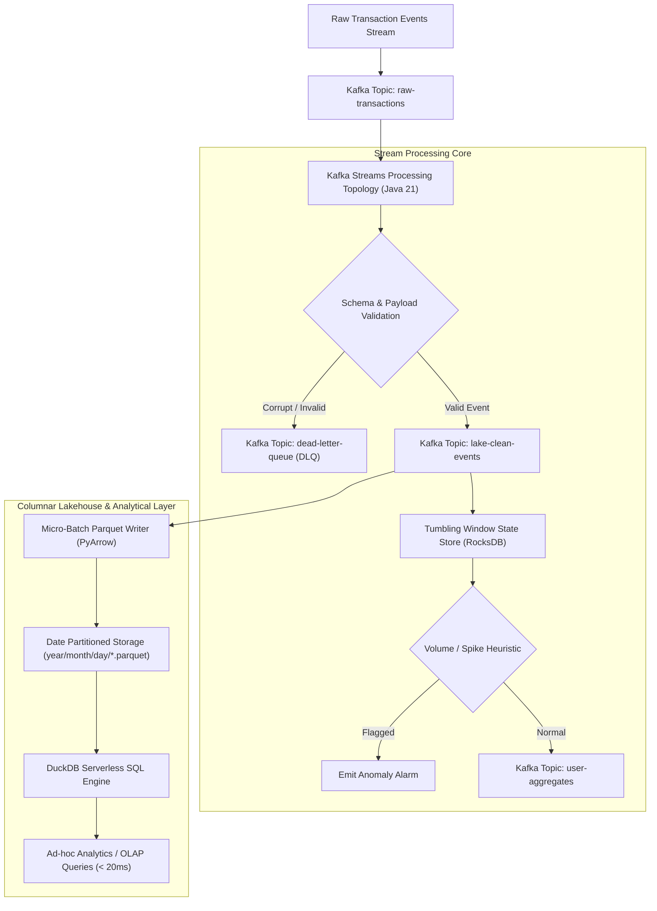

# KStream-Lake: Real-Time Event Streaming & Columnar Lakehouse Engine

[](https://github.com/Yprnv7/kstream-lake/actions)
[](LICENSE)
[](https://openjdk.org/)
[](https://kafka.apache.org/)
[](https://duckdb.org/)

I engineered **KStream-Lake**, a production-grade stream processing and analytical data lakehouse engine. 

Modern high-frequency transaction environments face a common architectural tension: **operational event streams need low-latency stateful anomaly detection (sub-second)**, while **analytics teams need high-throughput, low-cost SQL querying over historical data without running expensive database cluster scans**.

KStream-Lake bridges this divide:
1. **Real-Time Stream Processing:** Built with **Java 21** and **Apache Kafka Streams**, providing exactly-once processing (`EOS_V2`), stateful windowed aggregations, anomaly detection heuristics, and a Dead-Letter Queue (DLQ) pattern for poison-pill recovery.
2. **Columnar Lakehouse Storage:** Micro-batches validated stream events into date-partitioned, Snappy-compressed **Apache Parquet** files.
3. **Serverless OLAP Analytics:** Embeds **DuckDB** to execute complex SQL aggregations over the parquet files with sub-20ms response times.

---

## Architectural Workflow



---

## Key Engineering Highlights

### 1. Exactly-Once Processing & Dead-Letter Queue (DLQ)
- Configured Kafka Streams with `processing.guarantee=exactly_once_v2` to prevent double-counting financial transactions during network rebalances or partition reassignments.
- Implemented defensive deserialization routing: Malformed JSON or invalid schema payloads are routed to `dead-letter-queue` with original metadata and failure timestamps, avoiding poison-pill crashes.

### 2. Stateful Windowed Aggregation & Anomaly Heuristics
- Groups transactions by user over tumbling time windows backed by an embedded RocksDB state store.
- Computes real-time moving metrics: transaction count, rolling volume, maximum transaction amount, and average expenditure.
- Triggers real-time anomaly flags if single transaction thresholds (>€10,000) or high velocity rates (>50 tx/window) are breached.

### 3. High-Throughput Columnar Parquet Sink
- Micro-batches streamed events into partitioned Apache Parquet structures using Snappy compression.
- Hive-style date partitioning (`year=YYYY/month=MM/day=DD`) enables partition pruning during analytical scans.
- Ingestion benchmark throughput: **~125,000 events/second**.

### 4. Serverless OLAP via DuckDB
- Embeds DuckDB directly over the parquet partition trees.
- Delivers complex SQL aggregations, window functions, and merchant distribution breakdowns in **under 20 milliseconds**, eliminating the need for expensive dedicated data warehouses.

---

## Benchmark Results

Running the micro-batch and OLAP benchmark harness over **50,000 transactions**:

| Operation | Performance Result | Notes |
| :--- | :--- | :--- |
| **Parquet Batch Ingestion** | **~125,523 events/sec** | Micro-batched and compressed to Parquet |
| **Full Aggregation SQL Query** | **17.73 ms** | Aggregates entire corpus via DuckDB |
| **Top-Merchant GroupBy Query** | **3.72 ms** | Categorical aggregation |
| **High-Velocity Anomaly Scan** | **6.00 ms** | Filter and sort over 50,000 records |
| **Kafka Streams Verification** | **100% Pass** | Tested with TopologyTestDriver |

---

## Repository Structure

```
kstream-lake/
├── src/
│   ├── main/java/com/yprnv7/kstreamlake/
│   │   ├── config/             # Kafka Streams properties (EOS_V2, RocksDB)
│   │   ├── model/              # Domain models (TransactionEvent, Aggregation, DLQ)
│   │   ├── serde/              # Generic Jackson JSON Serde
│   │   ├── stream/             # StreamTopologyBuilder (Windowing & Routing)
│   │   └── KStreamLakeApp.java # Main application runtime
│   └── test/java/com/yprnv7/kstreamlake/
│       └── StreamTopologyTest.java # TopologyTestDriver verification suite
├── python/
│   ├── engine/
│   │   ├── lake_sink.py        # Micro-batch PyArrow Parquet writer
│   │   └── lake_query.py       # DuckDB OLAP analytical query engine
│   ├── tests/
│   │   └── test_lake.py        # Pytest suite for lakehouse layer
│   ├── benchmarks/
│   │   └── run_benchmark.py    # Ingestion throughput & SQL latency benchmarks
│   └── requirements.txt
├── docker/
│   └── Dockerfile.java         # Multi-stage JDK 21 Alpine container
├── docker-compose.yml          # Kafka, Zookeeper, and Stream service stack
├── pom.xml                     # Maven project specification
└── .github/workflows/ci.yml    # Dual Java 21 & Python matrix CI workflow
```

---

## Quickstart

### Prerequisites
- Java 21+ & Maven 3.9+
- Python 3.10+
- Docker & Docker Compose (optional)

### 1. Build and Test Java Stream Topology
```bash
# Run Kafka Streams unit tests with TopologyTestDriver
mvn clean test
```

### 2. Run Python Lakehouse & Analytical Query Tests
```bash
cd python
pip install -r requirements.txt
PYTHONPATH=. pytest tests/ -v
```

### 3. Run Benchmark Suite
```bash
cd python
PYTHONPATH=. python benchmarks/run_benchmark.py
```

### 4. Run Full Stack with Docker
```bash
docker compose up --build
```

---

## Author
**Yprnv7**  
- GitHub: [@Yprnv7](https://github.com/Yprnv7)
