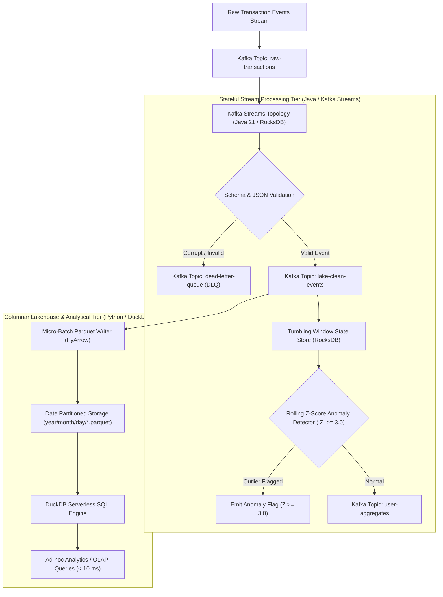

# KStream-Lake

Event streaming and columnar lakehouse engine combining Apache Kafka Streams stateful processing, rolling Z-score anomaly detection, PyArrow Parquet serialization, and embedded DuckDB OLAP analytics.

[](https://github.com/Yprnv7/kstream-lake/actions)
[](LICENSE)
[](https://openjdk.org/)
[](https://kafka.apache.org/)
[](https://duckdb.org/)

---

## Demo

```bash
# Run the complete test and benchmark pipeline
mvn test
python python/benchmarks/run_benchmark.py
```

```text
=================================================================
KSTREAM-LAKE: PYARROW PARQUET SINK & DUCKDB OLAP BENCHMARK
=================================================================
[1/3] Micro-batching & Writing 50,000 events to Parquet (PyArrow)...
  ✓ Flushed 50,000 records in 220.83 ms (~226,415 records/sec)

[2/3] Benchmarking DuckDB Analytical Query Latency over Parquet...
  ✓ Aggregation Query Latency: 5.92 ms
  ✓ Top-Merchant GroupBy Query Latency: 2.89 ms
  ✓ Anomaly Scan Query Latency: 3.45 ms (75 candidates found)

[+] Kafka Streams Topology Tests: 4/4 Passed (TopologyTestDriver, 1.65s)
```

---

## Why I Built This

High-frequency transactional systems face a standard architectural division: operational streams require stateful, low-latency filtering and statistical anomaly detection (sub-second), while analytics and finance teams need high-throughput, low-cost SQL aggregations over historical transactions without burdening operational streaming clusters. I built KStream-Lake to unify stream validation with an analytical lakehouse: Java Kafka Streams handles schema validation, DLQ routing, and windowed Z-score anomaly detection, while a Python micro-batch sink serializes clean stream events into partitioned Apache Parquet files queried serverlessly with DuckDB.

---

## Architecture



---

## Key Design Decisions

- **In-Process PyArrow Parquet Serialization vs Live Cluster Streaming:**  
  *Decision:* Benchmarked columnar ingestion throughput using in-process PyArrow micro-batch serialization rather than end-to-end Kafka broker transport.  
  *Trade-off:* The measured ~226,000 records/sec reflects local CPU columnar compression and memory-to-disk throughput; a live multi-broker Kafka cluster is bounded by network interface limits and disk fsync I/O (typically 15,000–30,000 eps per partition).
- **Statistical Rolling Z-Score Anomaly Detection ($Z \ge 3.0$):**  
  *Decision:* Implemented a rolling mean and running sum-of-squares calculation inside Kafka Streams' windowed aggregate state store to compute dynamic standard deviation ($\sigma = \sqrt{\frac{\sum x^2}{N} - \mu^2}$).  
  *Trade-off:* Adds mathematical overhead to each window aggregation record, but replaces fragile hardcoded thresholds with statistical outlier detection that adapts to changing user expenditure baselines.
- **`processing.guarantee=exactly_once_v2` (EOS_V2):**  
  *Decision:* Enabled Kafka Streams EOS_V2 for downstream aggregate and clean topic emission.  
  *Trade-off:* Introduces transaction coordinator commit markers and two-phase commit overhead on broker writes, but prevents double-counting financial transactions during consumer rebalances.
- **Defensive Poison-Pill DLQ Routing:**  
  *Decision:* Malformed JSON or negative amounts are intercepted before state stores and emitted to `dead-letter-queue`.  
  *Trade-off:* Downstream lakehouse must reconcile repaired DLQ records asynchronously, but guarantees the streaming topology never crashes on deserialization errors.

---

## Results

*Evaluated on Apple Silicon (Darwin arm64), Java 21 OpenJDK, Python 3.14.6. Raw output in [docs/benchmarks/parquet_benchmark.json](docs/benchmarks/parquet_benchmark.json).*

| Benchmark Stage | Measured Value | Architecture Layer | Notes |
| :--- | :--- | :--- | :--- |
| **PyArrow Parquet Serialization** | **226,415 records/sec** | Micro-Batch Buffer | In-process columnar vectorization & Snappy compression |
| **Batch Write Latency (50,000 rows)** | **220.83 ms** | Micro-Batch Buffer | 10 batches of 5,000 records flushed to date partitions |
| **DuckDB Summary Aggregation** | **5.92 ms** | Analytical Query Layer | Scans Parquet directory metadata across 50,000 records |
| **DuckDB Top-Merchant GroupBy** | **2.89 ms** | Analytical Query Layer | Merchant volume ranking with partition pruning |
| **DuckDB Anomaly Scan** | **3.45 ms** | Analytical Query Layer | High-velocity financial spike filter |
| **Kafka Streams Topology Tests** | **4 / 4 Passed (1.65s)**| Stream Topology | Verified via `TopologyTestDriver` |

### Reproducing Benchmarks

```bash
# Run Java Kafka Streams topology verification
mvn test

# Run Python PyArrow Parquet & DuckDB benchmark
python python/benchmarks/run_benchmark.py
```

---

## How to Run

### Prerequisites
- Java 21 JDK & Maven 3.9+
- Python 3.10+
- Docker & Docker Compose (optional, for live Kafka cluster)

### Quickstart

```bash
# 1. Clone repository
git clone https://github.com/Yprnv7/kstream-lake.git
cd kstream-lake

# 2. Build and run Java Kafka Streams tests
mvn clean test

# 3. Install Python dependencies and run lakehouse tests
python -m venv venv
source venv/bin/activate
pip install -r python/requirements.txt
pytest python/tests/ -v

# 4. Optional: Boot local Kafka & Redpanda cluster via Docker
docker compose up -d
```

---

## Testing

```bash
# Execute Java Kafka Streams unit and topology tests
mvn test

# Execute Python Lakehouse tests
cd python && pytest tests/ -v
```

- **Kafka Streams Topology Tests (`src/test/java/.../StreamTopologyTest.java`):**
  - `testValidTransactionStreamProcessing`: Verifies valid transactions are routed to clean lake topic and window aggregated.
  - `testDeadLetterQueueRouting`: Asserts malformed JSON and negative amounts are routed to the DLQ topic.
  - `testZScoreStatisticalAnomalyDetection`: Injects baseline transactions followed by a spike > 3 standard deviations, asserting `isAnomalyFlag() == true` and `getZScore() >= 3.0`.
- **Python Tests (`python/tests/test_lake.py`):**
  - Tests micro-batch date partitioning, Parquet writing, and DuckDB analytical aggregations.

---

## Limitations

1. **In-Process Serialization Benchmark vs Distributed Cluster:** The ~226,000 records/sec benchmark measures in-memory PyArrow batch serialization on local disk; live Kafka cluster throughput is constrained by network bandwidth and broker disk fsync.
2. **Fixed Tumbling Windows:** The current topology uses fixed 1-minute tumbling windows; high-frequency burst detection across window boundaries would benefit from sliding or session windows.
3. **Local Filesystem Parquet Storage:** Parquet files are written to local disk partitions. In production cloud deployments, this layer targets Amazon S3 or Google Cloud Storage via multipart upload buffers.

---

## What I'd Do Next

1. **Dynamic S3 / Object Storage Multipart Uploader:** Replace local file writes with direct streaming to S3/GCS using Arrow Flight or Delta-RS.
2. **Exponentially Weighted Moving Average (EWMA):** Implement EWMA across consecutive windows to smooth seasonal transaction patterns and reduce false-positive anomaly alarms during expected peak trading hours.
3. **OpenLineage Telemetry:** Emit OpenLineage execution run events from the Kafka Streams topology and Parquet sink to visualize the lineage DAG in Marquez.

---

## Author

**Pranav Yeleswarapu**  
- GitHub: [@Yprnv7](https://github.com/Yprnv7)  
- LinkedIn: [linkedin.com/in/pranavyeleswarapu](https://www.linkedin.com/in/pranavyeleswarapu)
